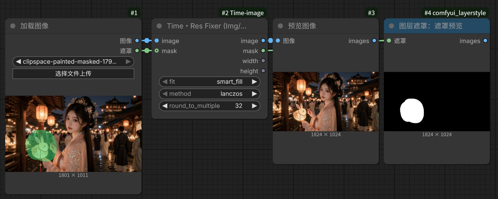

# Time image

Time image 是一个包含 **两个 ComfyUI 节点** 的小套装，当前版本 **2.1.0**。下面按节点顺序说明：先介绍提示词、参考图与分辨率一体节点，再介绍图像和遮罩对齐节点。

| 顺序 | 节点 | 适合做什么 |
| --- | --- | --- |
| 1 | **Time・Prompt + Images + Resolution**（中文界面：Time・提示词 + 图像 + 分辨率） | 写提示词、放参考图、设置生成尺寸。 |
| 2 | **Time・Res Fixer (Img/Mask)** | 将已有图像和可选遮罩对齐到指定倍数的尺寸。 |

两个节点都不需要下载模型，也不需要额外安装 Python 包。

## 安装

1. 在 ComfyUI Manager 中搜索 **Time image** 并安装；也可以用 **Install via Git URL** 填 `https://github.com/shiguanggougouo/Time-image`，或在命令行执行 `comfy node registry-install time-image`。
2. **重启 ComfyUI**：新节点的界面扩展和中英文翻译要重启后才会加载。

手动安装：把 `Time-image` 文件夹放入 `ComfyUI/custom_nodes/`，然后启动 ComfyUI。

## 1. Time・Prompt + Images + Resolution

这个节点把提示词、参考图和目标宽高放在一起。默认只显示提示词；勾选 **图片（Images）** 或 **分辨率（Resolution）** 后，才会展开相应设置。

### 使用步骤

1. **写提示词**：在提示词框输入内容。先导入图片，再输入 `@` 可从已导入图片中选择；选中后会插入带缩略图的 `<Picture N>` 标记。直接输入 `@图1`、`@图像1` 也会自动转成同样的标记。
2. **添加参考图（可选）**：打开 **图片**，点击 `+` 或把图片拖到节点里，最多 10 张。每张图片旁可单独启用或停用；点击 **替换图1**、**替换图2** 等按钮可更换对应图片，点击缩略图右上角 `×` 删除，点击缩略图可放大预览。英文界面会显示 **Replace Image 1** 等文字。
3. **设置尺寸（可选）**：打开 **分辨率**，选择宽高比（`1:1`、`3:2`、`2:3`、`4:3`、`3:4`、`16:9`、`9:16`、`21:9`、`9:21`），再选择「边长像素」或「百万像素」模式。边长像素可指定为最小边或最大边；可选预设，也可直接输入数字。尺寸对齐可选「关闭」、8、16、32 或 64。
4. **连接输出**：将 `宽度`、`高度` 接到需要宽高的节点；将 `提示词` 接到文本编码节点（例如 CLIP Text Encode）的文本输入；将 `图像 1`、`图像 2` 等接到模型的图像输入。

### 图片设置

- 图片通过 ComfyUI 上传到 `ComfyUI/input/time_image/`，不需要手动复制文件，也不经过外部服务。
- 勾选每张图旁的复选框可决定是否输出该图；关闭某张图不会改变其它图片的编号。
- 勾选 **限制图像最大边** 后，可选择最大边像素，节点只会缩小超过该尺寸的图片，不会放大小图。
- **所有图像对齐倍数** 可将启用的输入图统一对齐到「关闭」、8、16、32 或 64 的倍数。
- 输出端口随导入图片增减（最多 `image_10`）；停用的图片仍占一个编号，对应输出为空。

### 分辨率设置

- **边长像素**：输入边长像素，并选择它表示最小边还是最大边；另一边按宽高比计算。支持预设，也支持手动输入 64–16384。
- **百万像素**：直接输入百万像素目标，节点按宽高比计算最终宽高。
- **对齐倍数**：选择「关闭」、8、16、32 或 64。选择「关闭」时取整到像素；选择数值时会将宽高对齐到该倍数。
- **使用图像 1 分辨率**：使用第一张图的宽高，替代自定义分辨率。启用时需要先导入图像 1。
- 底部绿色结果行实时显示最终 MP 和宽高，例如 `1.05 MP · 1024 × 1024`。关闭 **分辨率** 时，宽高输出为 `1024 × 1024`。

> `<Picture N>` 是提示词里的引用标记，不会自动把图片接进模型。使用图像编辑或多图模型时，也要把对应的 `image_N` 输出连到模型。

### 输出

| 输出 | 类型 | 内容 |
| --- | --- | --- |
| `宽度`（`width`）、`高度`（`height`） | `INT` | 最终宽高。 |
| `提示词`（`prompt`） | `STRING` | 引用图片的位置会输出为 `<Picture N>`。 |
| `图像 1` … `图像 10`（`image_1` … `image_10`） | `IMAGE` | 按导入图片动态显示；编号与缩略图顺序一致。 |

## 2. Time・Res Fixer (Img/Mask)

当已有图像需要符合模型的尺寸倍数要求时使用。可选连接遮罩，节点会让图像和遮罩使用相同的缩放、裁切和补边位置。

### 使用步骤

1. 将待处理的图像接到 `image`。
2. 如果有遮罩，将它接到 `mask`；没有遮罩也可以使用。
3. 选择对齐倍数（`2、4、8、14、16、28、32、64、128、256、512`）、适配方式和图像重采样方式。
4. 将 `image` 和 `mask` 输出接到后续节点；`width` 和 `height` 可接到需要尺寸的节点。

对齐后的画布宽、高分别向上取到所选倍数。例如，`1801 × 1011` 对齐到 32 后为 `1824 × 1024`。此节点负责对齐，不用于把画布缩小到指定尺寸。

### 适配方式

| `fit` | 效果 |
| --- | --- |
| `smart_fill`（默认） | 等比适配，镜像补齐空白区域，不留黑边。 |
| `letterbox` | 等比适配，居中用黑色补齐空白区域。 |
| `crop` | 等比放大并从中心裁切，边缘内容可能被裁掉。 |
| `fill` | 直接拉伸到目标尺寸，画面比例可能改变。 |

图像可选 `lanczos`、`bicubic`、`hamming`、`bilinear`、`box` 或 `nearest` 重采样。遮罩始终使用最近邻方式处理，避免遮罩边界被模糊。未连接遮罩时，`mask` 输出为空白遮罩。

常用组合：SD / SDXL 潜空间选 `8` 或 `64`，patch-14 类模型选 `14` 或 `28`；一般情况下保持 `lanczos` + `smart_fill` 即可。

### 输出

| 输出 | 类型 | 内容 |
| --- | --- | --- |
| `image` | `IMAGE` | 对齐后的图像。 |
| `mask` | `MASK` | 与图像同步对齐的遮罩；未连接遮罩时输出空白遮罩。 |
| `width`、`height` | `INT` | 对齐后的画布宽高。 |

## License

MIT，见 [`LICENSE`](LICENSE)。全部为原创代码，未捆绑第三方代码或模型权重，可商用。

---

# English

Time image is a small pack of **two ComfyUI nodes**, currently at version **2.1.0**. The nodes are described in order below: first the all-in-one prompt, reference images and resolution node, then the image-and-mask alignment node.

| Order | Node | What it is for |
| --- | --- | --- |
| 1 | **Time・Prompt + Images + Resolution** (Chinese UI: Time・提示词 + 图像 + 分辨率) | Write a prompt, add reference images, and set the output size. |
| 2 | **Time・Res Fixer (Img/Mask)** | Align an existing image and an optional mask to dimensions divisible by a chosen multiple. |

Neither node downloads models or needs extra Python packages.

## Installation

1. Search **Time image** in ComfyUI Manager and install it. You can also use **Install via Git URL** with `https://github.com/shiguanggougouo/Time-image`, or run `comfy node registry-install time-image` from the command line.
2. **Restart ComfyUI**: the front-end extension and the English/Chinese translations are only loaded on startup.

Manual install: put the `Time-image` folder in `ComfyUI/custom_nodes/`, then start ComfyUI.

## 1. Time・Prompt + Images + Resolution

This node keeps the prompt, reference images and target width/height together. By default only the prompt is visible; tick **Images** or **Resolution** to reveal the corresponding settings.

### Your first workflow in four steps

1. **Write the prompt:** type in the prompt box. Import images first, then type `@` to pick one; a `<Picture N>` marker with a thumbnail is inserted. Typing `@图1` or `@图像1` is converted to the same marker automatically.
2. **Add reference images (optional):** enable **Images**, press `+` or drag files onto the node — up to 10. Each image can be enabled or disabled on its own. Use the **Replace Image 1**, **Replace Image 2**, … buttons to swap an image, the `×` on a thumbnail to delete it, and click a thumbnail to enlarge it. The Chinese UI shows **替换图1** and so on.
3. **Set the size (optional):** enable **Resolution**, pick an aspect ratio (`1:1`, `3:2`, `2:3`, `4:3`, `3:4`, `16:9`, `9:16`, `21:9`, `9:21`), then choose **Side pixels** or **Megapixels**. Side pixels can mean the shortest or longest edge; presets and manual values are both available. Alignment can be `OFF`, 8, 16, 32 or 64.
4. **Wire the outputs:** connect `width` / `height` to any size input, `prompt` to a text encoder (for example CLIP Text Encode), and `image_1`, `image_2`, … to the image inputs of your model.

### Image options

- Files are uploaded through ComfyUI into `ComfyUI/input/time_image/` — no manual copying, no external services.
- The checkbox next to each image decides whether it is output; disabling one does not renumber the others.
- With **Limit image max edge** enabled, pick a maximum edge in pixels. Only oversized images are shrunk; small ones are never enlarged.
- **Align all images to multiple of** snaps every enabled input image to `OFF`, 8, 16, 32 or 64.
- Output sockets appear as images are added (up to `image_10`). A disabled image still keeps its slot, and that output is empty.

### Resolution options

- **Side pixels:** enter the edge length and choose whether it is the shortest or longest edge; the other edge follows the aspect ratio. Presets are available, or type any value from 64 to 16384.
- **Megapixels:** enter a megapixel target; the node derives width and height from the aspect ratio.
- **Align to multiple:** `OFF`, 8, 16, 32 or 64. `OFF` rounds to whole pixels; a number rounds both dimensions to that multiple.
- **Use Image 1 resolution:** use the first image's size instead of a custom resolution. Image 1 must be imported first.
- The green result line shows the final MP and size live, e.g. `1.05 MP · 1024 × 1024`. With **Resolution** off, the output is `1024 × 1024`.

> `<Picture N>` is a text marker in the prompt; it does not attach the image to the model automatically. For image editing or multi-image models, also connect the matching `image_N` output.

### Outputs

| Output | Type | Notes |
| --- | --- | --- |
| `width`, `height` (`宽度`, `高度` in the Chinese UI) | `INT` | Final width and height. |
| `prompt` (`提示词`) | `STRING` | Image references are emitted as `<Picture N>`. |
| `image_1` … `image_10` (`图像 1` … `图像 10`) | `IMAGE` | Shown dynamically to match imported images; numbering follows the thumbnail order. |

## 2. Time・Res Fixer (Img/Mask)

Use it when an existing image must meet a model's dimension-multiple requirement. A mask is optional; the node applies the same scaling, cropping and padding positions to both.

### Steps

1. Connect the image to `image`.
2. Connect a mask to `mask` if you have one; the node also works without a mask.
3. Choose the alignment multiple (`2, 4, 8, 14, 16, 28, 32, 64, 128, 256, 512`), a fit mode and an image resampling method.
4. Connect the `image` and `mask` outputs to the next nodes; `width` and `height` can go to any size input.

The aligned canvas rounds width and height **up** to the chosen multiple. For example, `1801 × 1011` aligned to 32 becomes `1824 × 1024`. This node aligns; it is not meant to shrink a canvas to a target size.

### Fit modes

| `fit` | Effect |
| --- | --- |
| `smart_fill` (default) | Proportional fit; remaining space is filled with mirrored content, so there are no black bars. |
| `letterbox` | Proportional fit; centered black padding. |
| `crop` | Proportional upscale with a center crop; edge content may be lost. |
| `fill` | Direct stretch to the target size; the aspect ratio may change. |

Images can use `lanczos`, `bicubic`, `hamming`, `bilinear`, `box` or `nearest` resampling. Masks always use nearest-neighbour so their edges stay sharp. With no mask connected, the `mask` output is an empty (all-zero) mask.

Common picks: `8` or `64` for SD / SDXL latents, `14` or `28` for patch-14 style models; `lanczos` + `smart_fill` is a good general default.

### Outputs

| Output | Type | Notes |
| --- | --- | --- |
| `image` | `IMAGE` | The aligned image. |
| `mask` | `MASK` | The mask aligned with the image; empty when no mask is connected. |
| `width`, `height` | `INT` | The aligned canvas width and height. |

## License

MIT — see [`LICENSE`](LICENSE). This package contains only original code, with no third-party code or model weights bundled, and may be used commercially.
