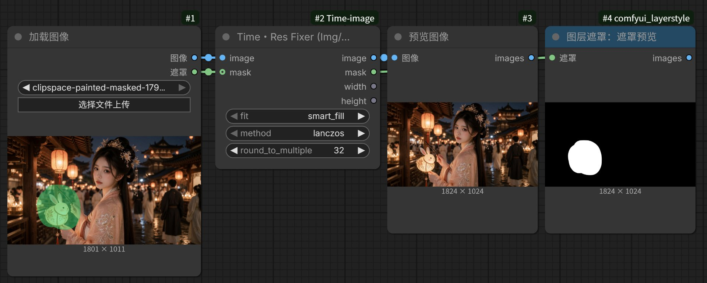

# Time image

A single, dependency-free ComfyUI node: **Time・Res Fixer (Img/Mask)** aligns an image and its optional mask to dimensions divisible by a chosen multiple, then outputs the resulting width and height as integers for downstream nodes.

No model weights, no downloads, no network access, no extra Python packages — only `numpy`, `torch` and `Pillow`, which ComfyUI already provides. The entire package is MIT-licensed.

## Node

- **Time・Res Fixer (Img/Mask)** — fit an image and optional mask to a divisible canvas, keeping both pixel-aligned.

## Installation

- In ComfyUI Manager, search for `Time image` (Comfy Registry), or use **Install via Git URL** with `https://github.com/shiguanggougouo/Time-image`.
- From the command line: `comfy node registry-install time-image`.
- Or copy the `Time-image` folder into `ComfyUI/custom_nodes/` and restart ComfyUI.

No model files need to be downloaded.

## What changed in 2.0.0

The pose extraction nodes (OpenPose / DWPose) and the depth extraction nodes (Depth Anything V2) were removed, together with all bundled third-party code and automatic model downloads. Workflows that used `Time Pose Extractor`, `Time Depth Model Loader` or `Time Depth Extractor` need to replace those nodes. The package is now one lightweight node under a plain MIT license, with no non-commercial restrictions.

## Time・Res Fixer (Img/Mask) in detail

This node is an **input alignment** step rather than a general resizer. It brings an image and its mask to dimensions divisible by a chosen multiple, using one shared geometry for both. It loads no model weights, needs no network access, and is fully deterministic.

*Workflow example: an 1801×1011 image and its mask are aligned to 1824×1024 with `round_to_multiple = 32`; the image and mask outputs stay pixel-aligned.*

### Dimensions

`target = ceil(original / round_to_multiple) * round_to_multiple` — sizes only grow, never shrink, by at most `multiple - 1` pixels. Available multiples: `2, 4, 8, 14, 16, 28, 32, 64, 128, 256, 512`.

- `8 / 32 / 64` match VAE and latent downsampling (SD 1.5 / SDXL).
- `14 / 28` match the patch-14 grid used by Depth Anything / DINO-family models, so no pixels get cropped away downstream.
- `2` is enough when only even dimensions are required.

### Fit modes

| `fit` | Scaling | Handling the remainder | Result |
| --- | --- | --- | --- |
| `smart_fill` (default) | Proportional, `min` scale | Mirror padding, equivalent to OpenCV `BORDER_REFLECT_101` (edge pixel not repeated) | No black bars, no distortion |
| `letterbox` | Proportional, `min` scale | Center padding with `0` | Full composition, black bars |
| `crop` | Proportional, `max` scale | Center crop | Full bleed, edge content lost |
| `fill` | Direct stretch to target | None | Slight aspect distortion |

Example: a 1000×600 image aligned to 64 becomes 1024×640; proportional scaling gives 1024×614, and the missing 26 pixels of height are filled with mirrored content.

### Image and mask stay aligned

- The image uses one of six PIL filters (`lanczos` by default, plus `bicubic`, `hamming`, `bilinear`, `box`, `nearest`); the mask always uses `nearest`, so binary edges and soft mask values are preserved instead of being blurred into intermediate grey.
- Scaling, cropping and padding share exactly the same coordinates on both paths. In `smart_fill` the mask is mirrored too, in `letterbox` it is padded with `0`, and in `crop` it is cropped at the same center.
- A single mask is broadcast across the whole image batch; a mismatched batch count raises a clear error. If the mask resolution differs from the image, it is first resampled to the image size with `nearest`.
- With no mask connected, the node returns an all-zero mask (`0` means unselected in ComfyUI), so all four outputs are always available and the chain never breaks.

### Outputs and behaviour

`image`, `mask`, `width` (`INT`), `height` (`INT`). The integer width and height can be wired straight into Empty Latent Image, KSampler or upscale nodes, so downstream resolution follows the input automatically.

The node validates `IMAGE` as `[B,H,W,C]` with 1, 3 or 4 channels and `MASK` as `[B,H,W]`, and whitelists `fit` / `method`. Grayscale is handled as PIL `L` and restored to a channel dimension; RGBA works too. Output dtype and device follow the inputs (fp16 / bf16 / GPU tensors pass through), and `ascontiguousarray` plus `detach()` keep the tensors clean.

### Limitations

- It only pads upward; it cannot scale an image down to a fixed resolution such as 512.
- Frames pass through `uint8` quantization (`round(x*255)`), so results are not bit-exact.
- Resampling runs per frame on the CPU via PIL: 4K inputs, large batches or video are slower, with a GPU↔CPU round trip.
- `smart_fill` mirrors mask edges into the padded area. If a mask touches the canvas edge and must stay exact, use `letterbox` instead.
- `letterbox` is always centered black padding; there is no custom pad colour, pad position or arbitrary target resolution.

**Quick picks:** SD/SDXL latent → `8` or `64`; Depth Anything / DINO-family models → `14` or `28`; even dimensions only → `2`. For general use, `lanczos` + `smart_fill` is a good default.

## License

MIT — see [`LICENSE`](LICENSE). This package contains only original code: no third-party code and no model weights are bundled, so it may be used commercially.

# Time image（中文说明）

Time image 是一个独立的 ComfyUI 节点包，只提供 **Time・Res Fixer (Img/Mask)**：把图像与可选遮罩按同一套几何对齐到指定倍数的尺寸，并以整数输出最终宽高给下游节点。

不加载模型权重、不下载文件、不联网、不需要额外 Python 包 —— 只依赖 ComfyUI 自带的 `numpy`、`torch` 和 `Pillow`。整个包采用 MIT 许可。

## 节点

- **Time・Res Fixer (Img/Mask)**：将图像和可选遮罩调整到指定倍数的画布尺寸，两路输出保持像素级对齐。

## 安装

- 在 ComfyUI Manager 中搜索 `Time image`（Comfy Registry），或用 **Install via Git URL** 填 `https://github.com/shiguanggougouo/Time-image`。
- 命令行：`comfy node registry-install time-image`。
- 或将 `Time-image` 文件夹复制到 `ComfyUI/custom_nodes/`，然后重启 ComfyUI。

无需下载任何模型文件。

## 2.0.0 的变化

姿态提取节点（OpenPose / DWPose）与深度提取节点（Depth Anything V2）已移除，随包附带的第三方代码和模型自动下载逻辑也一并删除。曾使用 `Time Pose Extractor`、`Time Depth Model Loader` 或 `Time Depth Extractor` 的工作流需要改用其它节点替代。现在整个包是一个轻量单节点、纯 MIT 许可，不再有非商业限制。

## 节点详解：Time・Res Fixer (Img/Mask)

这个节点的定位是**输入对齐**，而不是通用缩放：它把图像与遮罩用同一套几何一起补齐到指定倍数，再交给下游模型。全程不加载权重、不联网、结果完全确定，也是本包中唯一、也是最轻量稳定的一环。

*工作流示例：1801×1011 的图像与遮罩经 `round_to_multiple = 32` 对齐为 1824×1024，输出的图像与遮罩保持像素级对齐。*

### 尺寸规则

`目标尺寸 = ceil(原尺寸 / round_to_multiple) × round_to_multiple`，**只增不减**，最多比原图多出 `倍数 - 1` 像素。可选倍数：`2, 4, 8, 14, 16, 28, 32, 64, 128, 256, 512`。

- `8 / 32 / 64` 对应 VAE 与 latent 下采样（SD 1.5 / SDXL）。
- `14 / 28` 对应 Depth Anything / DINO 系模型按 patch 14 裁切的网格，提前对齐可以避免下游悄悄裁掉像素。
- 只需要偶数尺寸时，`2` 就够。

### 四种 fit 模式

| `fit` | 缩放方式 | 剩余空间处理 | 效果 |
| --- | --- | --- | --- |
| `smart_fill`（默认） | 等比，`min` 比例 | 镜像反射填充，等同 OpenCV `BORDER_REFLECT_101`（边缘像素不重复） | 无黑边、不变形 |
| `letterbox` | 等比，`min` 比例 | 居中补 `0` | 保留完整构图，有黑边 |
| `crop` | 等比，`max` 比例 | 中心裁切 | 铺满画面，丢失边缘内容 |
| `fill` | 直接拉伸到目标尺寸 | 无 | 轻微形变 |

例：1000×600 按 64 对齐得到 1024×640；等比缩放后为 1024×614，缺少的 26 像素高度由镜像内容补齐。

### 图像与遮罩严格同步

- 图像提供 6 种 PIL 重采样（默认 `lanczos`，另有 `bicubic`、`hamming`、`bilinear`、`box`、`nearest`）；遮罩固定使用 `nearest`，保留二值边界与软边数值，不会被插值糊出中间灰度。
- 缩放、裁切、补边在两路上共用完全相同的坐标：`smart_fill` 时遮罩同样镜像，`letterbox` 时补 `0`，`crop` 时按同一中心裁切。
- 单张遮罩自动广播到整个图像 batch；数量不一致会明确报错。若遮罩分辨率与图像不同，会先用 `nearest` 校正到图像尺寸，再走同一套几何。
- 未连接遮罩时返回全 `0` 的遮罩（ComfyUI 中 `0` 表示未选中），四个输出始终齐全，链路不会中断。

### 输出与行为

输出为 `image`、`mask`、`width`（`INT`）、`height`（`INT`）。整数宽高可以直接接到 Empty Latent Image、KSampler 或放大节点，上游更换分辨率时下游自动跟随，无需手算。

节点会校验 `IMAGE` 为 `[B,H,W,C]` 且通道数为 1/3/4、`MASK` 为 `[B,H,W]`，并对 `fit` / `method` 做白名单检查。灰度图按 PIL `L` 处理并补回通道维，RGBA 同样可用。输出的 dtype 与 device 跟随输入（fp16 / bf16 / GPU 张量可直接透传），`ascontiguousarray` 与 `detach()` 保证张量内存连续、不带计算图。

### 使用边界

- 只向上补齐，不能把图像缩小到 512 之类的固定分辨率。
- 每帧经过 `round(x*255)` 的 uint8 量化，结果不是逐位精确。
- 重采样在 CPU 上用 PIL 逐帧进行：4K 输入、大 batch 或视频会较慢，并有一次 GPU↔CPU 往返。
- `smart_fill` 会把遮罩边缘镜像到补边区域；若遮罩贴着画布边缘且要求精确，改用 `letterbox`。
- `letterbox` 固定为居中黑边，暂不支持自定义填充颜色、填充位置或任意目标分辨率。

**参数速选**：SD/SDXL latent 用 `8` 或 `64`；Depth Anything / DINO 系模型用 `14` 或 `28`；只需偶数用 `2`。常规出图推荐 `lanczos` + `smart_fill`。

## 许可

MIT 许可，完整条款见 [`LICENSE`](LICENSE)。本包只含原创代码，不含第三方代码，也不附带模型权重，可用于商业用途。
