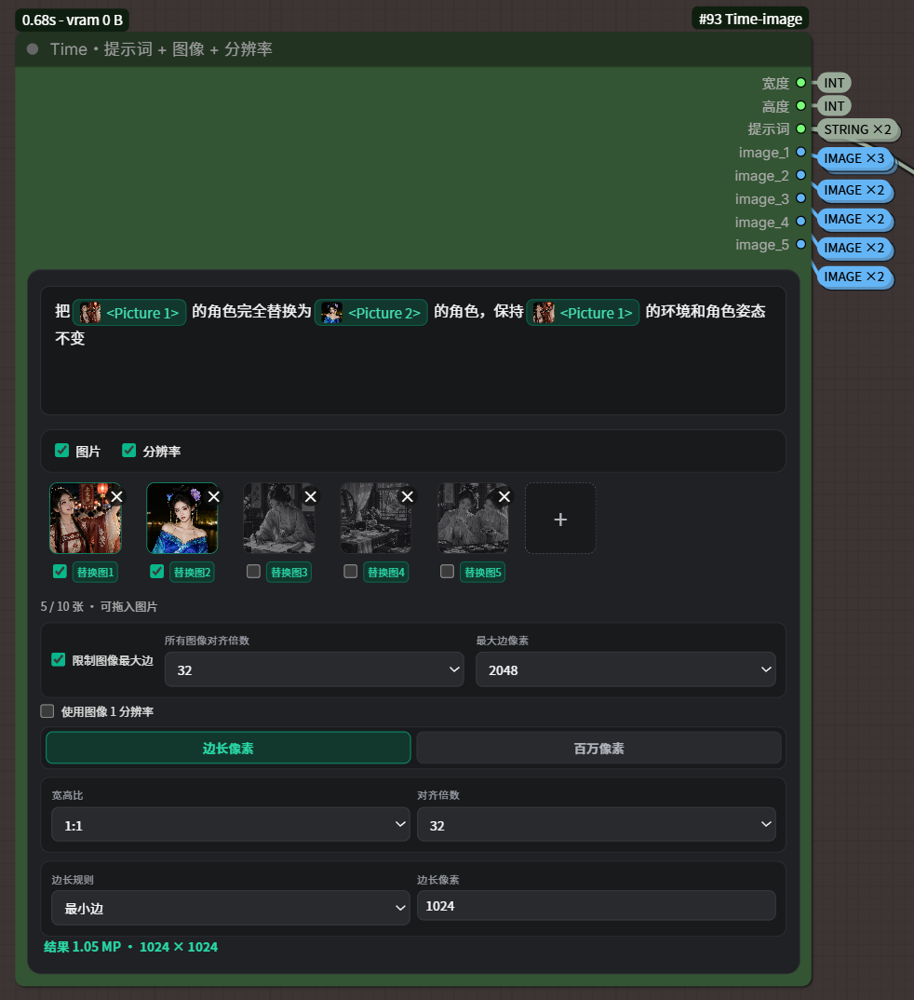
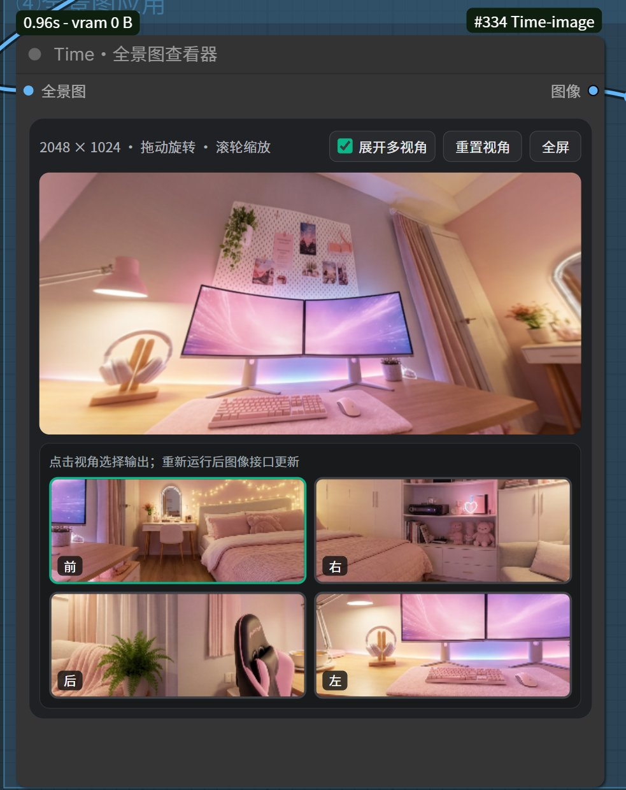
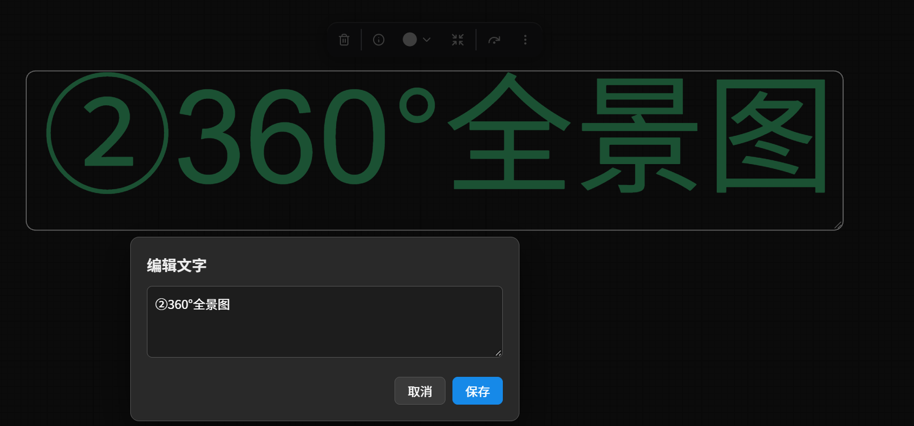

# Time image

Time image 是一个包含 **八个 ComfyUI 节点** 的小套装，当前版本 **2.6.5**。下面按顺序介绍提示词、图像与分辨率节点、图像和遮罩对齐节点、全景图查看器、缓存清理器、偏移修复、完成提示音、专用 GGUF 模型加载器，以及文字标签。

| 顺序 | 节点 | 适合做什么 |
| --- | --- | --- |
| 1 | **Time・Prompt + Images + Resolution**（中文界面：Time・提示词 + 图像 + 分辨率） | 写提示词、放参考图、设置生成尺寸。 |
| 2 | **Time・Res Fixer (Img/Mask)** | 将已有图像和可选遮罩对齐到指定倍数的尺寸。 |
| 3 | **Time・Panorama Viewer**（中文界面：Time・全景图查看器） | 交互查看全景图，并将当前视角或选中的多视角透视图输出。 |
| 4 | **Time・Cache Cleaner**（中文界面：Time・缓存清理器） | 在工作流完成后，按开关清理模型或节点执行缓存。 |
| 5 | **Time・Offset Repair**（中文界面：Time・偏移修复） | 自动识别 AI 编辑后的变化，只把改动合成回原图并尽量保留背景。 |
| 6 | **Time・Play Sound**（中文界面：Time・播放声音） | 工作流运行到此节点时，在浏览器播放短提示音，并可调节音量。 |
| 7 | **Time・GGUF UNET Loader** | 使用已安装的 GGUF Loader 加载 GGUF UNET。 |
| 8 | **Time・文字标签** | 在画布直接显示说明文字；双击编辑，右键设置字号和颜色。 |

这些节点不需要下载模型或模型权重。图像合成器使用 OpenCV；当前 ComfyUI 环境已提供，无需另行安装。如果移植到没有 OpenCV 的环境，需要在该 ComfyUI 的 Python 环境安装 `opencv-python`。

## 安装

1. 在 ComfyUI Manager 中搜索 **Time image** 并安装；也可以用 **Install via Git URL** 填 `https://github.com/shiguanggougouo/Time-image`，或在命令行执行 `comfy node registry-install time-image`。
2. **重启 ComfyUI**：新节点的界面扩展和中英文翻译要重启后才会加载。

手动安装：把 `Time-image` 文件夹放入 `ComfyUI/custom_nodes/`，然后启动 ComfyUI。

## 1. Time・Prompt + Images + Resolution

这个节点把提示词、参考图和目标宽高放在一起。默认只显示提示词；勾选 **图片（Images）** 或 **分辨率（Resolution）** 后，才会展开相应设置。

保存工作流时，图片、分辨率、限制图像最大边、使用图像 1 分辨率，以及每张图的启用状态都会一起保存；切换到其他工作流再切回来时，会按工作流保存的状态恢复。

### 使用步骤

1. **写提示词**：在提示词框输入内容。先导入图片，再输入 `@` 可从已导入图片中选择；选中后会插入带缩略图的 `<Picture N>` 标记。直接输入 `@图1`、`@图像1` 也会自动转成同样的标记。
2. **添加参考图（可选）**：打开 **图片**，点击 `+` 或把图片拖到节点里，最多 10 张。每张图片旁可单独启用或停用；点击 **替换图1**、**替换图2** 等按钮可更换对应图片，点击缩略图右上角 `×` 删除，点击缩略图可放大预览。英文界面会显示 **Replace Image 1** 等文字。
3. **设置尺寸（可选）**：打开 **分辨率**，选择「宽高比」「自定宽高」或「百万像素」模式。宽高比模式包含 `2:1` 和 `1:2`，并可设定边长像素；自定宽高模式可直接输入宽度和高度。尺寸对齐可选「关闭」、8、16、32 或 64。
4. **连接输出**：将 `宽度`、`高度` 接到需要宽高的节点；将 `提示词` 接到文本编码节点（例如 CLIP Text Encode）的文本输入；将 `图像 1`、`图像 2` 等接到模型的图像输入。

### 图片设置

- 图片通过 ComfyUI 上传到 `ComfyUI/input/time_image/`，不需要手动复制文件，也不经过外部服务。
- 勾选每张图旁的复选框可决定是否输出该图；关闭某张图不会改变其它图片的编号。
- 勾选 **限制图像最大边** 后，可选择最大边像素，节点只会缩小超过该尺寸的图片，不会放大小图。
- **所有图像对齐倍数** 可将启用的输入图统一对齐到「关闭」、8、16、32 或 64 的倍数。
- 输出端口随导入图片增减（最多 `image_10`）；停用的图片仍占一个编号，对应输出为空。

### 分辨率设置

- **边长像素**：输入边长像素，并选择它表示最小边还是最大边；另一边按宽高比计算。支持预设，也支持手动输入 64–16384。
- **百万像素**：直接输入百万像素目标，节点按宽高比计算最终宽高。
- **自定义宽高**：分别输入宽度和高度像素；所选对齐倍数仍会应用到最终尺寸。
- **对齐倍数**：选择「关闭」、8、16、32 或 64。选择「关闭」时取整到像素；选择数值时会将宽高对齐到该倍数。
- **使用图像 1 分辨率**：使用第一张图的宽高，替代自定义分辨率。启用时需要先导入图像 1。
- 底部绿色结果行实时显示最终 MP 和宽高，例如 `1.05 MP · 1024 × 1024`。关闭 **分辨率** 时，宽高输出为 `1024 × 1024`。

> `<Picture N>` 是提示词里的引用标记，不会自动把图片接进模型。使用图像编辑或多图模型时，也要把对应的 `image_N` 输出连到模型。

### 输出

| 输出 | 类型 | 内容 |
| --- | --- | --- |
| `宽度`（`width`）、`高度`（`height`） | `INT` | 最终宽高。 |
| `提示词`（`prompt`） | `STRING` | 引用图片的位置会输出为 `<Picture N>`。 |
| `图像 1` … `图像 10`（`image_1` … `image_10`） | `IMAGE` | 按导入图片动态显示；编号与缩略图顺序一致。 |

## 2. Time・Res Fixer (Img/Mask)

当已有图像需要符合模型的尺寸倍数要求时使用。可选连接遮罩，节点会让图像和遮罩使用相同的缩放、裁切和补边位置。

### 使用步骤

1. 将待处理的图像接到 `image`。
2. 如果有遮罩，将它接到 `mask`；没有遮罩也可以使用。
3. 选择对齐倍数（`2、4、8、14、16、28、32、64、128、256、512`）、适配方式和图像重采样方式。
4. 将 `image` 和 `mask` 输出接到后续节点；`width` 和 `height` 可接到需要尺寸的节点。

对齐后的画布宽、高分别向上取到所选倍数。例如，`1801 × 1011` 对齐到 32 后为 `1824 × 1024`。此节点负责对齐，不用于把画布缩小到指定尺寸。

### 适配方式

| `fit` | 效果 |
| --- | --- |
| `smart_fill`（默认） | 等比适配，镜像补齐空白区域，不留黑边。 |
| `letterbox` | 等比适配，居中用黑色补齐空白区域。 |
| `crop` | 等比放大并从中心裁切，边缘内容可能被裁掉。 |
| `fill` | 直接拉伸到目标尺寸，画面比例可能改变。 |

图像可选 `lanczos`、`bicubic`、`hamming`、`bilinear`、`box` 或 `nearest` 重采样。遮罩始终使用最近邻方式处理，避免遮罩边界被模糊。未连接遮罩时，`mask` 输出为空白遮罩。

常用组合：SD / SDXL 潜空间选 `8` 或 `64`，patch-14 类模型选 `14` 或 `28`；一般情况下保持 `lanczos` + `smart_fill` 即可。

### 输出

| 输出 | 类型 | 内容 |
| --- | --- | --- |
| `image` | `IMAGE` | 对齐后的图像。 |
| `mask` | `MASK` | 与图像同步对齐的遮罩；未连接遮罩时输出空白遮罩。 |
| `width`、`height` | `INT` | 对齐后的画布宽高。 |

## 3. Time・Panorama Viewer

将等距柱状全景图接到 `全景图`，运行后可拖动预览旋转、滚轮缩放。图像输出口会输出画布当前视角对应的透视图。

打开 **展开多视角** 后会显示前、右、后、左四个方向的预览卡片。点击卡片选择视角，再运行工作流，图像输出口就会得到该方向的透视图；关闭开关时输出画布当前视角。视角图默认宽边为 1024 像素，画面比例跟随查看器。批次输入会对每张图应用相同视角。

此节点适用于常见的 **2:1 等距柱状全景图**。其他比例也会尝试投影，但效果可能不正确。

### 输出

| 输出 | 类型 | 内容 |
| --- | --- | --- |
| `图像`（`image`） | `IMAGE` | 当前视角或所选多视角的透视图。 |

## 4. Time・Cache Cleaner

将节点放入工作流并运行，即会在本轮工作流全部结束后执行所选清理，避免在采样或模型仍被使用时中途卸载。

- **清理模型缓存**：卸载 ComfyUI 管理的已加载模型，释放它们占用的显存；下次使用时需要重新加载。默认关闭，适合需要反复使用固定模型的工作流。
- **清理执行缓存**：清空节点执行结果缓存，并回收未被引用的 Python 对象和 PyTorch 未使用的显存缓存。模型开关关闭时，已加载模型会保留；节点结果缓存清空后，下次运行可能需要重新计算节点。
- 两个开关都关闭时不执行清理。只想保留固定模型并清理执行结果时，只开启 **清理执行缓存**。

### 输出

| 输出 | 类型 | 内容 |
| --- | --- | --- |
| `状态`（`status`） | `STRING` | 本次缓存清理操作的状态。 |

## 5. Time・Offset Repair

当 AI 编辑图与原图大体保持同一构图，但生成结果顺带改变了背景色调或其它未编辑区域时，使用此节点把改动区域合成回原图。

### 使用步骤

> 两个图像输入现在都是可选的：只接一张时会直接透传该图并输出空白改动遮罩；两张都断开时输出 1×1 空白图像与遮罩，方便临时断开调试而不报错。

1. 把 AI 编辑后的结果接到 **编辑后图像**（第一个图像输入）。
2. 把未编辑的原图接到 **原图**（第二个图像输入）。
3. 如果只允许局部合成，把区域遮罩接到可选的 **局部合成遮罩**：白色区域应用修复结果，黑色区域保留对齐后的编辑图；遮罩会限制修复范围。可用 **遮罩羽化（像素）** 柔化两者边界；范围为 `0–256` 像素，默认 `0`。
4. 将 **合成图像** 接到后续工作流。可选地查看 **改动遮罩**：显示修复范围内自动检测到的编辑贡献；灰色边缘表示柔和过渡。

节点内部会自动进行特征配准、稳健色彩匹配、改动检测和柔边合成，不需要额外参数或模型。可选遮罩能把合成限制在手选区域内。两张图尺寸不同时会尝试自动对齐，合成结果保持原图尺寸。支持单张图，也支持相同长度的批次；单张图或遮罩可复用于一个批次。

适合局部修改、人物或物体替换等“主体场景基本不变”的编辑。若编辑结果改变了镜头、构图或大部分场景，自动识别的范围可能扩大，建议先检查 **改动遮罩**。

### 输出

| 输出 | 类型 | 内容 |
| --- | --- | --- |
| `合成图像`（`composited_image`） | `IMAGE` | 将编辑区域融入原图、其它区域尽量保留原图的结果。 |
| `改动遮罩`（`change_mask`） | `MASK` | 软遮罩；显示修复范围内检测到的编辑贡献。 |

## 6. Time・Play Sound

把最终图像（例如 **保存图像** 节点的 `images` 输出）接到 **触发图像**。工作流运行到此节点时，ComfyUI 页面会播放一声短促清脆的提示音；可用 **音量** 滑块调节音量。

## 7. Time・GGUF UNET Loader

仅加载 `.gguf` 文件，并直接使用已安装的 **GGUF Loader** 扩展。需要先安装并启用提供 `LoaderGGUF` 的 GGUF 节点。

## 8. Time・文字标签

这是一个只在画布显示的说明标签，没有输入、输出或计算功能。双击文字可编辑内容（支持换行）；右键节点并选择 **文字属性…**，可以设置字号和文字颜色。文字和样式会随工作流保存。

## License

MIT，见 [`LICENSE`](LICENSE)。全部为原创代码，未捆绑第三方代码或模型权重，可商用。

---

# English

Time image is a small pack of **eight ComfyUI nodes**, currently at version **2.6.5**. The nodes are described in order below: prompt, images and resolution; image-and-mask alignment; panorama viewer; cache cleaner; AI edit compositing; a completion chime; a dedicated GGUF loader; and a text label.

| Order | Node | What it is for |
| --- | --- | --- |
| 1 | **Time・Prompt + Images + Resolution** (Chinese UI: Time・提示词 + 图像 + 分辨率) | Write a prompt, add reference images, and set the output size. |
| 2 | **Time・Res Fixer (Img/Mask)** | Align an existing image and an optional mask to dimensions divisible by a chosen multiple. |
| 3 | **Time・Panorama Viewer** (Chinese UI: Time・全景图查看器) | Inspect a panorama and output the current camera view or a selected multi-view perspective. |
| 4 | **Time・Cache Cleaner** (Chinese UI: Time・缓存清理器) | Clear model or node execution caches after the workflow finishes. |
| 5 | **Time・Offset Repair** (Chinese UI: Time・偏移修复) | Detect changes in an AI edit, composite them into the original, and preserve the background where possible. |
| 6 | **Time・Play Sound** (Chinese UI: Time・播放声音) | Play an adjustable-volume completion chime when the workflow reaches this node. |
| 7 | **Time・GGUF UNET Loader** | Load GGUF UNETs through the installed GGUF Loader extension. |
| 8 | **Time・Text Label** (Chinese UI: Time・文字标签) | Show text on the canvas; double-click to edit and right-click to set its size and color. |

These nodes do not download models or model weights. The image compositing node uses OpenCV, which is already available in this ComfyUI environment. If you move it to an installation without OpenCV, install `opencv-python` in that ComfyUI Python environment.

## Installation

1. Search **Time image** in ComfyUI Manager and install it. You can also use **Install via Git URL** with `https://github.com/shiguanggougouo/Time-image`, or run `comfy node registry-install time-image` from the command line.
2. **Restart ComfyUI**: the front-end extension and the English/Chinese translations are only loaded on startup.

Manual install: put the `Time-image` folder in `ComfyUI/custom_nodes/`, then start ComfyUI.

## 1. Time・Prompt + Images + Resolution

This node keeps the prompt, reference images and target width/height together. By default only the prompt is visible; tick **Images** or **Resolution** to reveal the corresponding settings.

When you save a workflow, the Images and Resolution switches, the maximum-edge limit, Use Image 1 resolution, and each image's enabled state are saved with it and restored when you return to that workflow.

### Your first workflow in four steps

1. **Write the prompt:** type in the prompt box. Import images first, then type `@` to pick one; a `<Picture N>` marker with a thumbnail is inserted. Typing `@图1` or `@图像1` is converted to the same marker automatically.
2. **Add reference images (optional):** enable **Images**, press `+` or drag files onto the node — up to 10. Each image can be enabled or disabled on its own. Use the **Replace Image 1**, **Replace Image 2**, … buttons to swap an image, the `×` on a thumbnail to delete it, and click a thumbnail to enlarge it. The Chinese UI shows **替换图1** and so on.
3. **Set the size (optional):** enable **Resolution**, then select **Aspect Ratio**, **Custom Size** or **Megapixels**. Aspect Ratio includes `2:1` and `1:2`, with an edge-pixel setting; Custom Size lets you enter width and height directly. Alignment can be `OFF`, 8, 16, 32 or 64.
4. **Wire the outputs:** connect `width` / `height` to any size input, `prompt` to a text encoder (for example CLIP Text Encode), and `image_1`, `image_2`, … to the image inputs of your model.

### Image options

- Files are uploaded through ComfyUI into `ComfyUI/input/time_image/` — no manual copying, no external services.
- The checkbox next to each image decides whether it is output; disabling one does not renumber the others.
- With **Limit image max edge** enabled, pick a maximum edge in pixels. Only oversized images are shrunk; small ones are never enlarged.
- **Align all images to multiple of** snaps every enabled input image to `OFF`, 8, 16, 32 or 64.
- Output sockets appear as images are added (up to `image_10`). A disabled image still keeps its slot, and that output is empty.

### Resolution options

- **Side pixels:** enter the edge length and choose whether it is the shortest or longest edge; the other edge follows the aspect ratio. Presets are available, or type any value from 64 to 16384.
- **Megapixels:** enter a megapixel target; the node derives width and height from the aspect ratio.
- **Custom size:** enter width and height in pixels; the selected alignment still applies to the final dimensions.
- **Align to multiple:** `OFF`, 8, 16, 32 or 64. `OFF` rounds to whole pixels; a number rounds both dimensions to that multiple.
- **Use Image 1 resolution:** use the first image's size instead of a custom resolution. Image 1 must be imported first.
- The green result line shows the final MP and size live, e.g. `1.05 MP · 1024 × 1024`. With **Resolution** off, the output is `1024 × 1024`.

> `<Picture N>` is a text marker in the prompt; it does not attach the image to the model automatically. For image editing or multi-image models, also connect the matching `image_N` output.

### Outputs

| Output | Type | Notes |
| --- | --- | --- |
| `width`, `height` (`宽度`, `高度` in the Chinese UI) | `INT` | Final width and height. |
| `prompt` (`提示词`) | `STRING` | Image references are emitted as `<Picture N>`. |
| `image_1` … `image_10` (`图像 1` … `图像 10`) | `IMAGE` | Shown dynamically to match imported images; numbering follows the thumbnail order. |

## 2. Time・Res Fixer (Img/Mask)

Use it when an existing image must meet a model's dimension-multiple requirement. A mask is optional; the node applies the same scaling, cropping and padding positions to both.

### Steps

1. Connect the image to `image`.
2. Connect a mask to `mask` if you have one; the node also works without a mask.
3. Choose the alignment multiple (`2, 4, 8, 14, 16, 28, 32, 64, 128, 256, 512`), a fit mode and an image resampling method.
4. Connect the `image` and `mask` outputs to the next nodes; `width` and `height` can go to any size input.

The aligned canvas rounds width and height **up** to the chosen multiple. For example, `1801 × 1011` aligned to 32 becomes `1824 × 1024`. This node aligns; it is not meant to shrink a canvas to a target size.

### Fit modes

| `fit` | Effect |
| --- | --- |
| `smart_fill` (default) | Proportional fit; remaining space is filled with mirrored content, so there are no black bars. |
| `letterbox` | Proportional fit; centered black padding. |
| `crop` | Proportional upscale with a center crop; edge content may be lost. |
| `fill` | Direct stretch to the target size; the aspect ratio may change. |

Images can use `lanczos`, `bicubic`, `hamming`, `bilinear`, `box` or `nearest` resampling. Masks always use nearest-neighbour so their edges stay sharp. With no mask connected, the `mask` output is an empty (all-zero) mask.

Common picks: `8` or `64` for SD / SDXL latents, `14` or `28` for patch-14 style models; `lanczos` + `smart_fill` is a good general default.

### Outputs

| Output | Type | Notes |
| --- | --- | --- |
| `image` | `IMAGE` | The aligned image. |
| `mask` | `MASK` | The mask aligned with the image; empty when no mask is connected. |
| `width`, `height` | `INT` | The aligned canvas width and height. |

## 3. Time・Panorama Viewer

Connect an equirectangular panorama to `Panorama image` and run the workflow. Drag the preview to rotate and scroll to zoom. The image output returns a perspective crop of the current viewer angle.

Enable **Multi-view** to show Front, Right, Back and Left preview cards. Select a card and run the workflow to send that perspective to the image output. With the switch off, the output uses the current viewer angle. The output is 1024 pixels on its long edge and follows the viewer aspect ratio. Batches receive the same selected view.

The viewer is designed for common **2:1 equirectangular panoramas**. Other ratios are projected as well, but may look incorrect.

### Output

| Output | Type | Notes |
| --- | --- | --- |
| `Image` (`image`) | `IMAGE` | The current or selected perspective view. |

## 4. Time・Cache Cleaner

Add this node to a workflow and queue it. Cleanup is scheduled for after the whole workflow finishes, so models are not unloaded while sampling or other nodes still need them.

- **Clear model cache:** unloads ComfyUI-managed models and frees their VRAM. They must be loaded again when next used. Off by default, which suits workflows that repeatedly use the same models.
- **Clear execution cache:** clears cached node execution results, runs Python garbage collection, and empties unused PyTorch device-memory cache. With the model switch off, loaded models stay resident; cached node results are cleared, so some nodes may need to run again on the next prompt.
- If both switches are off, no cleanup is scheduled. To keep fixed models loaded while clearing execution results, enable only **Clear execution cache**.

### Output

| Output | Type | Notes |
| --- | --- | --- |
| `Status` (`status`) | `STRING` | The status of the scheduled cache cleanup. |

## 5. Time・Offset Repair

Use this node when an AI-edited image keeps roughly the same composition as the original, but also changes background colors or other areas you wanted to keep.

### Steps

> Both image inputs are optional now: with only one connected, that image is passed through with an empty change mask; with neither connected, the node returns a 1x1 blank image and mask so it can stay in a workflow while you debug.

1. Connect the AI result to **Edited image** (the first image input).
2. Connect the untouched image to **Original image** (the second image input).
3. To restrict compositing to a selected area, connect a region mask to **Local composite mask**. White applies the repaired result; black keeps the aligned edited image. Set **Mask feather (px)** to soften the boundary; it ranges from `0` to `256` pixels and defaults to `0`.
4. Send **Composited image** to the next node. Optionally inspect **Change mask**: shows detected edit contribution inside the repair mask; gray edges provide a soft transition.

The node automatically aligns the images, matches color from structurally stable regions, detects changes and blends soft edges. It has no model downloads. **Mask feather (px)** controls how softly the optional mask edge blends; it defaults to `0`. White mask areas receive the repaired result, while black areas preserve the aligned edited image. Different input sizes are automatically aligned when possible; the result keeps the original image dimensions. Single images and equal-length batches are supported; a single image or mask can be reused against a batch.

It works best for local edits, such as changing a person or object while keeping the scene and camera mostly unchanged. If the edit changes the camera, composition or most of the scene, the detected mask may cover a larger area, so inspect **Change mask** first.

### Outputs

| Output | Type | Notes |
| --- | --- | --- |
| `Composited image` (`composited_image`) | `IMAGE` | The edit blended into the original, with other areas preserved where possible. |
| `Change mask` (`change_mask`) | `MASK` | A soft mask showing detected edit contribution inside the repair mask. |

## 6. Time・Play Sound

Connect the final image, such as the `images` output of **Save Image**, to **Trigger image**. When the workflow reaches this node, the ComfyUI browser plays a short, bright chime. Adjust its loudness with the **Volume** slider.

## 7. Time・GGUF UNET Loader

Loads only `.gguf` files through the installed **GGUF Loader** extension. Install and enable a GGUF node that provides `LoaderGGUF` first.

## 8. Time・Text Label

This is a canvas-only label with no inputs, outputs, or execution logic. Double-click the text to edit it (line breaks are supported). Right-click the node and choose **Text properties…** to adjust the font size and text color. The text and style are saved with the workflow.

## License

MIT — see [`LICENSE`](LICENSE). This package contains only original code, with no third-party code or model weights bundled, and may be used commercially.
